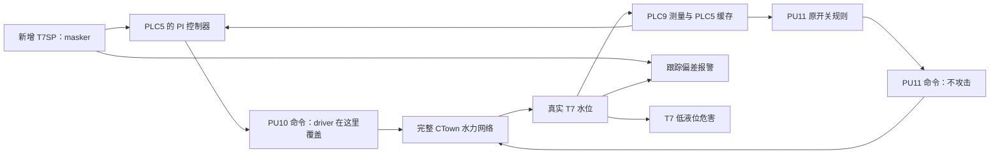

# T7 主场景控制链与注入层级核查

日期：2026-11-07。对应配置确认清单 A。核查原源码提交 `fd404fcf1d12ce72154c207ce59801d3c5cbdfc4` 与当前送审场景定义；没有运行新 PI 场景。

## 范围与结论

依据交接文档 5.1–5.3、13.5 和 15.2，本次以 T7 低液位危害为目标，主攻击变量对为 `PU10_SPEED_CMD + T7_LEVEL_SP`。用户本次明确继续按 T7 主场景梳理，因此不把全 CTown 的控制器列为新的攻击对象。整个 CTown 水力网络、其他设备与原控制仍保留；“以 T7 为主场景”不是只模拟一个水箱，也不能据此声称其他设备没有水力影响。

原五项变量表是“两个可攻击变量＋三个只读主变量”，不是五个攻击点，也不是平台全量点位表。A 项在本范围内已完成静态核查。若今后需要证明更广泛的注入点筛选或更深层级的覆盖，须另行明确实验范围；当前小场景本身不能提供这种证据。

## 原 CTown 的真实控制关系

- PLC9 持有 T7 液位传感器；PLC5 持有 PU10、PU11 执行器。PLC5 通过远端数据/缓存取得 T7。
- 原 INP 中以 T7 为条件的控制规则共四条，目标设备只有 PU10 和 PU11：PU10 在 T7<1.5 m 时开、T7>4.8 m 时关；PU11 在 T7<0.5 m 时开、T7>3 m 时关。未满足条件时保持现有状态。
- 当前 CTown 决策配置明确 PU10 使用 `rule`。PU11 未单独指定决策方式，PLC 混合控制分支默认也使用 `rule`。
- PLC5 还控制 PU8，但它的原控制条件是 T5，不在本次 T7 的直接控制依赖链中。不把“同属 PLC5”当作“属于 T7 控制链”的依据。
- PU10 连接 J307→J317，PU11 连接 J309→J323。P402 连接 J307/J309，P410 连接 J323/J317；T7 接入管网的管道为 P752（J297/T7）。泵命令通过水力网络影响 T7，并非泵直接连接水箱。
- 旧核查已验证 PU10 开关可改变 T7 轨迹；PU11 对新 PI 场景的定量影响与危害可达性仍须后续实验验证。

## 新主场景的控制链

PI、T7SP 与新报警是拟新增功能，不能将此图当作原 WaCSim 已有实现。PU11 支路保留，其行为与 PU10 在水力网络中共同作用。

## 层级怎样计数

本记录按“从注入位置沿前向执行链到物理过程，还要经过多少个控制计算器”计数：执行器命令记为 0；经过一个 PI 的设定值记为 1。不把传输、缓存、数据库转存、PLC 进程数量、管道数量或反馈回路再循环计为额外控制层级。这是本次梳理的数值约定，第三阶段对接 CRAVE 时还需映射到其字段格式。

| 本次允许攻击的点 | 位置及范围 | 剩余控制器数量 | 用途与状态 |
| --- | --- | --- | --- |
| PU10_SPEED_CMD | PLC5 PI 输出之后、进入水力过程之前；0–1 相对泵速 | 0 | 低层 driver；新确定性 ramp 待实现 |
| T7_LEVEL_SP | 新 T7SP，被 PLC5 PI 用作设定值；0–5 m | 1 | 高层 masker；虚拟 tag 与注入逻辑待实现 |

这两项代表相差一个控制器的两个注入位置。把 SP 放在 PLC9、通过网络传给 PLC5，不会因此变成两个控制层级；目前也没有额外的高层控制器负责自动生成这个 SP，不能凭 tag 的存放位置虚构更深的控制链。

## T7 关联信号清单与排除原因

| 信号或位置 | 当前关系 | 本次是否作为额外攻击点及原因 |
| --- | --- | --- |
| EPANET 真实 T7_LEVEL | 危害与报警真值 | 否；真实过程状态不直接篡改 |
| PLC9 的 T7 测量、PLC5 的 T7 缓存 | PI 和 PU11 原规则的反馈输入；属于同一逻辑测量的传输/缓存环节 | 否；已约定测量不受攻击，不拆成多个攻击点充数 |
| T7SP | PI 输入，同时参与跟踪报警 | 是；即上述 T7_LEVEL_SP，不另算第二个 tag 点位 |
| PI 计算得到的 PU10 命令与最终执行命令 | 同一输出链在覆盖前后的两个记录位置 | 只允许最终命令处的 driver 覆盖；两种记录用于验证覆盖关系，不算两个独立攻击点 |
| PU11 命令 | 与 T7 相关的另一执行器输出，属于直接执行命令层 | 否；保留原规则，作为未受攻击的反馈支路。它是应记录的关联点，不自动加入搜索空间 |
| T7S | 原 SCADA 机制生成的测量标签；原 seq_mitm 配置确实引用它 | 否；不是 T7SP。当前 PU10 选择 rule，没有证据将 T7S 当作额外的有效 SP/控制层；也不能仅凭攻击 YAML 中出现标签就认定其被当前控制器消费 |
| ScadaCommand_PU10 / ScadaCommand_PU11 | 混合模式支持的 SCADA 命令通道 | 否；当前规则分支不以它们替代本地控制输出。新 PI 方案亦未约定使用该分支，不把未选中的备选通道算作串联的上层控制器 |
| PU10_FLOW、J317_PRESSURE | 已列入主变量表的辅助观测 | 否；不参与攻击限幅、主控制输入或主报警/危害判定 |
| PU11F、J307 等其他原观测/节点 | 保留在原平台中，可用于解释水力轨迹 | 否；当前没有将其引入新增 T7 控制公式的依据；仅存在并不产生新的控制层级 |
| Kp、Ki、积分状态、控制阈值与决策方式配置 | 正常控制器参数、内部状态或配置 | 否；本次攻击改变约定的运行信号，不修改这些内部参数或模式 |

## 覆盖关系与实现注意

只攻击 SP 时，PI 会据此改变泵速。攻击 PU10 最终命令时，PI 仍可能计算和更新积分，但送给水力过程的是覆盖后的命令。双攻击期间 SP 仍参与报警计算；SP 与 PU10 ramp 分别参数化，实际执行顺序由场景控制。日志必须分别保留 PI 计算输出与实际执行输出。

原 `physical_process.update_controls` 对接近 0/1 的值使用 EPANET `STATUS`，其他数值使用 `SETTING`；因此原 PU10 tag 并不处处等价于纯泵速字段。第二阶段实现新速度命令时，必须明确开关状态与速度共同更新的方式，并验证例如 0.6→1.0 时实际速度确实恢复为 1.0。此处是代码实现与验证事项，不新增攻击变量或改变已批准范围。

## 核查依据

| 文件 | 核查位置 |
| --- | --- |
| `examples/ctown_topology/ctown_map.inp` | 407 行 T7；852–853 行两泵端点；1122–1126 行 T7 条件规则；P402/P410/P752 的连接 |
| `examples/ctown_topology/ctown_plcs.yaml` | 36 行起 PLC5 设备；58 行起 PLC9/T7 |
| `examples/ctown_topology/ctown_decision_plc.yaml` | 11 行起 PU10 的 rule 决策 |
| `wacsim/python2/generic_plc.py` | 330 行起读取本地值/远端缓存；581 行起混合模式分支及默认 rule；629 行起在控制后应用设备攻击 |
| `wacsim/python2/generic_scada.py` | 172 行起生成带 S 后缀的测量标签；418 行起 SCADA 控制计算；487 行起按配置转发测量 |
| `examples/ctown_topology/ctown_Seqmitm.yaml` | 原攻击引用 T7 和 T7S；引用存在不等于当前路径有效 |
| `wacsim/physical_process.py` | 414 行起读取执行器值并选择 STATUS/SETTING |
| `D:\2026\DockerData\audit\CTown短测试与基线核查.md` | 原控制基线与 PU10 开关对照证据 |

这些依据支持当前 T7 主场景的控制链和点位范围，不构成全 CTown 所有水力因果路径的穷举，也不等于新增场景已完成运行验收。
